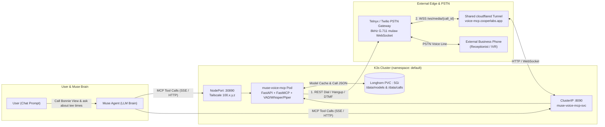

# Muse Voice MCP Bridge (`muse-voice-mcp`)

A self-hosted outbound phone call **"Ears & Mouth" MCP server** that gives Muse the ability to dial external businesses, speak using local Text-to-Speech, listen and transcribe responses using local Speech-to-Text, navigate keypad IVR menus, and report findings back to you—using Muse's own LLM brain for every conversational turn.

## Telephony Cost Comparison: Telnyx vs. Twilio

Because all Voice Activity Detection (`Silero VAD`), Speech-to-Text (`faster-whisper`), and Text-to-Speech (`Piper` / `Kokoro-ONNX`) run locally on your K3s cluster, **AI inference and voice synthesis cost \$0.00/min**. Your only cost is raw PSTN phone line termination:

| Cost Component | Telnyx (Default & Cheapest) | Twilio (Supported Fallback) | Savings with Telnyx |
|---|---|---|---|
| **Local US Phone Number** | **\$1.00 / month** | \$1.15 / month | ~13% cheaper |
| **Outbound US Call Rate** | **\$0.005 – \$0.007 / min** | \$0.014 / min | **~50–64% cheaper** |
| **Bidirectional Media Stream** | **~\$0.002 / min** | \$0.004 / min | **~50% cheaper** |
| **Total Per-Minute Rate** | **~\$0.007 – \$0.009 / min** | **~\$0.018 / min** | **~50%+ cheaper overall** |
| **Typical 90-Second Errand Call** | **~1.1 cents (\$0.011)** | ~2.7 cents (\$0.027) | Pennies per errand |

Both providers are natively supported via `TELEPHONY_PROVIDER=telnyx` (default) or `TELEPHONY_PROVIDER=twilio`.

## System Architecture



## Turn-by-Turn MCP Tool Loop

| MCP Tool | Purpose | Built-in Guardrails |
|---|---|---|
| `start_phone_call(phone_number, call_context, timeout_seconds)` | Dials the external business, waits for them to answer and finish their opening greeting, and returns `{call_id, they_said}`. | Status webhook aborts immediately on `busy` / `no-answer`. |
| `speak_and_listen(call_id, what_to_say, listen_timeout_seconds)` | Synthesizes `what_to_say` via local TTS, streams 8kHz $\mu$-law frames over the WebSocket, waits for the clerk to finish speaking, and returns `{they_said}`. | **Barge-in clear** if interrupted + **1.25s Delayed Filler** (*"Got it, one moment..."*) + **25s Hold Guard**. |
| `wait_on_hold(call_id, timeout_seconds)` | Continues listening silently when the clerk says *"Hold on while I check"* without timing out the MCP client. | Returns `{status: "still_on_hold"}` every 30s until speech resumes. |
| `send_dtmf(call_id, digits, listen_after)` | Sends RFC 2833 keypad tones (`0-9`, `*`, `#`, `w`) to navigate automated phone trees (*"Press 1 for front desk"*). | Automatically listens for the next menu prompt after pressing digits. |
| `end_phone_call(call_id, parting_words, summary_for_user)` | Speaks `parting_words`, hangs up via Telnyx/Twilio REST API, and writes the full transcript JSON to `/data/calls/{call_id}.json`. | Returns full timestamped transcript + call duration. |

## Quickstart (Local Development & Tests)

```bash
cd /Users/joshuacooper/muse-voice-mcp
python3 -m venv .venv
source .venv/bin/activate
pip install -r requirements.txt
pytest
```

## K3s Deployment (`linux/amd64` + Longhorn + Cloudflare Tunnel)

```bash
chmod +x deploy.sh
./deploy.sh
```
